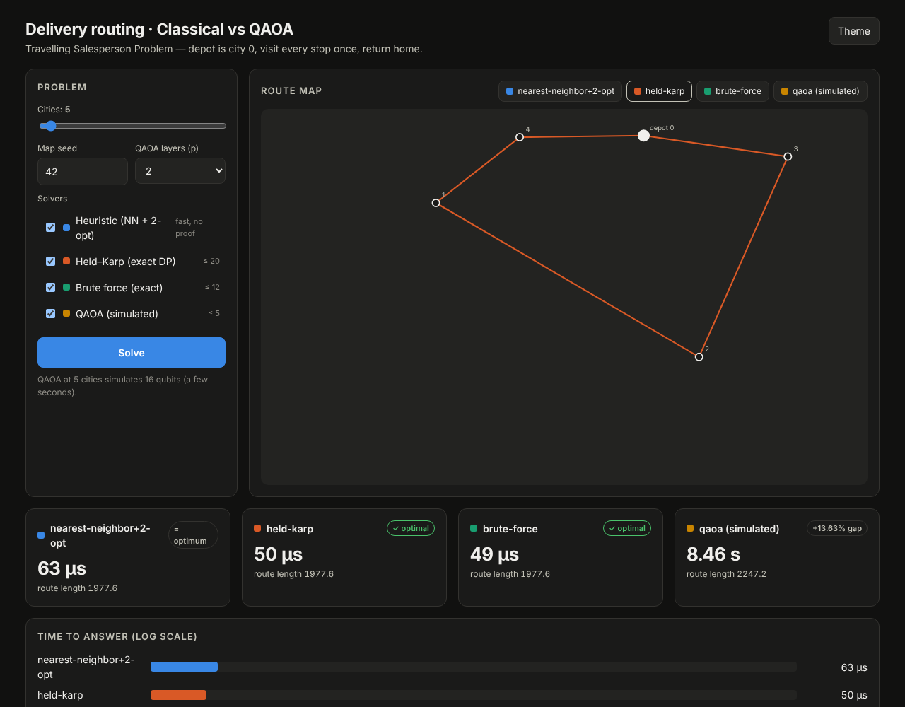
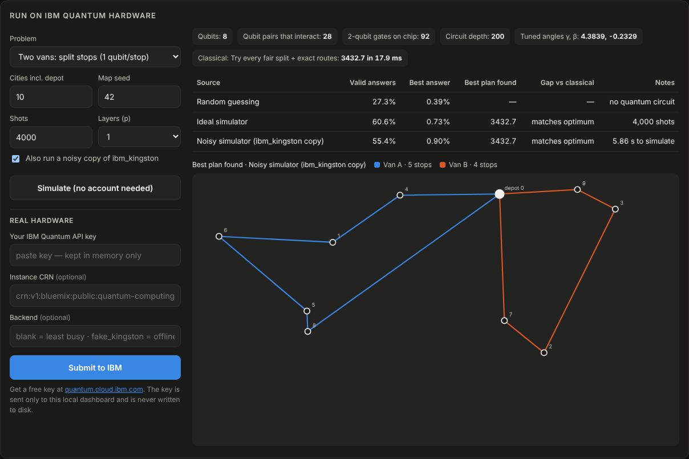

# Delivery Routing: Classical vs QAOA

**IBM Hackathon, Problem 06: "A routing problem: deliveries on a small map".**
We encode a small delivery-routing problem as a QUBO, solve it with QAOA (simulated *and*
on real IBM quantum hardware), compare it against strong classical solvers, and measure
where the quantum approach breaks down.



---

## TL;DR

| | What we found |
|---|---|
| **Classical** | A fast heuristic (nearest neighbour + 2-opt) solves 60 cities in about 0.3 s. Exact Held–Karp handles about 20 cities. Brute force stops at about 12. |
| **QAOA, full route** | The standard one-hot encoding needs **(n−1)² qubits**: 9 for 4 cities, 16 for 5 and 361 for 20. QAOA makes the best route **about 10–60× more likely than random guessing**, but a single shot is still rarely optimal. |
| **QAOA, two-van split** | Asking the quantum computer only *which van serves each stop* needs **1 qubit per stop**. That keeps circuits shallow enough for today's hardware, and the best plan appears in the samples. |
| **Real maps** | Click real places on an OpenStreetMap map (or search, or load the Kolkata example). Distances come from real roads, and every solver, quantum hardware included, runs on that map. |
| **Honest verdict** | No quantum advantage at these sizes: classical solvers are faster and exact. The value of this project is showing *why* and *where* the quantum approach breaks down, and running a real hardware experiment end to end. |

---

## Repository layout

```
.
├── classical/              # Classical solvers (no quantum anywhere)
│   ├── solvers.py          #   heuristic (NN + 2-opt), Held–Karp, brute force
│   └── benchmark.py        #   repeatable JSON/CSV benchmarks
│
├── quantum_simulation/     # Quantum algorithm, simulated on a normal computer
│   ├── qubo.py             #   TSP route  -> QUBO, (n−1)² qubits
│   ├── vehicle_split.py    #   two-van split -> QUBO, 1 qubit per stop
│   └── simulator.py        #   exact state-vector QAOA simulator + angle tuning
│
├── quantum_hardware/       # Real quantum hardware (IBM Quantum, via Qiskit)
│   ├── circuits.py         #   QUBO + tuned angles -> Qiskit circuit, compiled for a chip
│   ├── experiment.py       #   one experiment: map, encoding, baseline, scoring
│   └── ibm_runner.py       #   noisy simulation, submit job to IBM, poll status
│
├── shared/                 # Used by all three
│   ├── mapgen.py           #   made-up maps (same seed = same map)
│   ├── realmap.py          #   real places: road distances (OSRM), search (Nominatim)
│   ├── instance.py         #   one "map" object (made-up or real) for every solver
│   └── scaling.py          #   measured + projected cost of every approach
│
├── dashboard/              # Local web UI (Python standard library only)
│   ├── server.py
│   └── web/                #   index.html + bundled Leaflet map library
│
├── tests/                  # one test file per folder above
├── docs/                   # screenshots
├── app.py                  # python app.py   -> opens the dashboard
├── cli.py                  # python cli.py … -> command-line interface
├── requirements.txt        # optional: numpy (faster simulator)
└── requirements-hardware.txt  # qiskit + IBM runtime + aer (only for quantum_hardware/)
```

The folders only depend "downwards": `classical` uses `shared`; `quantum_simulation` uses
`classical` (for the exact baseline) and `shared`; `quantum_hardware` uses all of them.

---

## Quick start

Requires **Python 3.10+**.

```bash
git clone <your-repo-url>
cd <repo-folder>
python -m venv .venv
source .venv/bin/activate            # Windows: .venv\Scripts\activate

pip install -r requirements.txt      # optional (numpy), but recommended
python app.py                        # opens http://127.0.0.1:8000
```

Nothing else is required for the classical solvers, the QAOA simulator or the dashboard.

### Run the tests

```bash
python -m unittest discover -s tests -t . -v
```

### Command line

```bash
python cli.py solve --cities 10 --method both        # heuristic + Held–Karp
python cli.py solve --cities 11 --method brute       # try every route
python cli.py solve --cities 4  --method qaoa        # simulated QAOA
python cli.py benchmark --sizes 8,10,12,14 --seeds 1,2,3 --output results.csv
```

---

## Maps: made-up or real

Every solver only ever sees a **distance table** (how far each place is from every other
place). Where that table comes from is up to you:

| Map type | Where the places come from | Distance between places | Internet? |
|---|---|---|---|
| **Made-up** | random dots in a 1000 × 1000 square, set by a *seed* | straight line | no |
| **Real, straight line** | real latitude/longitude | great-circle (haversine) | no* |
| **Real, by road** | real latitude/longitude | driving distance along streets ([OSRM](https://project-osrm.org/)) | yes |

\* Map tiles and place search always need internet.

Changing the seed gives a different made-up map, and therefore a different best route.

**In the dashboard:** switch *Problem → Real map*, then:

- click the map to add stops (the first place is the depot), or
- search for a place by name (OpenStreetMap Nominatim), or
- load the **Kolkata (sample)** example: a depot at Sealdah plus 9 well-known places
  (approximate coordinates).

Click a pin or the × in the list to remove a stop. Routes are drawn along the actual streets.
The same real map is used by the **IBM hardware panel**, so the quantum computer splits real
deliveries between two vans.

**From the command line:**

```bash
python cli.py solve --example kolkata --method both
python cli.py solve --places my_shops.json --distance road
```

where `my_shops.json` looks like:

```json
[
  {"name": "Warehouse", "lat": 22.5678, "lon": 88.3710},
  {"name": "Shop A",    "lat": 22.5851, "lon": 88.3468},
  {"name": "Shop B",    "lat": 22.5448, "lon": 88.3426}
]
```

Notes:

- If road distances can't be fetched (no internet, or the service is busy), the app falls
  back to straight-line distances and says so on screen.
- Roads can be one-way, so A→B may differ from B→A. The solvers assume they are equal, so
  the app averages the two directions.
- The public OSRM and Nominatim servers are free for light use. For heavier use, run your own
  OSRM server and set `OSRM_URL` (and `NOMINATIM_URL` for search).
- Up to 20 places per real map. Each solver's own limit still applies (for example, two vans
  on hardware: up to 15 places).

---

## The dashboard

`python app.py` opens a page with:

1. **Solve:** pick a made-up or real map and the solvers. You get the route on a map, the time
   and route length for each solver, and the gap to the proven optimum.
2. **QAOA details:** qubits used, the chance that one shot is the optimal tour versus random
   guessing, the chance it is a valid tour, and the parameter-tuning curve.
3. **Measured scaling:** times every solver on *your* computer from 6 to 16 cities.
4. **Run on IBM quantum hardware:** ideal vs noisy vs real-chip comparison (see below).
5. **Where each approach breaks down:** valid tours, qubits, projected classical run time
   and simulator memory for 4–25 cities.

---

## Running on real IBM quantum hardware



```bash
pip install -r requirements-hardware.txt
python app.py
```

In the **Run on IBM quantum hardware** panel:

1. **Pick a problem.**
   - *Two vans*: 1 qubit per stop, each van takes half the stops. Recommended for real hardware.
   - *One route*: the full encoding. Only realistic at 4 cities (9 qubits).
2. **Click "Simulate".** No account is needed. This tunes the QAOA angles on your laptop,
   then shows the ideal result and a noisy simulation of IBM's `ibm_kingston` chip.
3. **Paste your own IBM Quantum API key and click "Submit to IBM".**
   - Get a free key at [quantum.cloud.ibm.com](https://quantum.cloud.ibm.com).
   - Leave *Backend* blank to use the least busy device.
   - Jobs wait in IBM's queue, and the page checks on them every 5 seconds.

Only the final, tuned circuit is sent to IBM, so one run uses seconds of quantum time.
IBM's free plan includes 10 minutes per 28 days at the time of writing.
Gate twirling and dynamical decoupling (IBM's built-in error suppression) are switched on.

> **Rehearse offline:** type `fake_kingston` as the backend. The run uses a local copy of the
> chip's noise and is clearly labelled *"Offline rehearsal, not real hardware"*.

### Real map → quantum computer

With **Real map** and **By road** selected, the IBM panel solves the same street distances as
the classical solvers:

```
OpenStreetMap road distances (OSRM)  →  distance table (metres)
  →  QUBO weights (savings between stops)  →  RZ / RZZ gate angles  →  IBM chip
  →  measured van split  →  each van routed on the same road distances
```

The panel shows which distances were used ("Distances: road distance (OpenStreetMap / OSRM)").
If road data could not be fetched, it shows a ⚠ warning, and the run uses straight-line
distances instead. "Simulate" and "Submit to IBM" always use the identical circuit.
`tests/test_realmap.py::test_quantum_hardware_uses_street_distances` checks this path.

### Your API key stays yours

- The project never stores a key. The key you paste goes only to the dashboard running on your
  own computer, which passes it to IBM for that one job.
- Alternatives to pasting: set the `QISKIT_IBM_TOKEN` environment variable, or run
  `QiskitRuntimeService.save_account(channel="ibm_quantum_platform", token="...")` once.
- `.gitignore` excludes `.env` and token files. **Never commit a key.**

---

## How it works

### Classical solvers (`classical/`)

| Solver | Exact? | Work grows like | Practical limit |
|---|---|---|---|
| Nearest neighbour + 2-opt (multi-start) | no | ~n³–n⁴ | hundreds of cities |
| Held–Karp dynamic programming | yes | n² · 2ⁿ | ~20 cities |
| Brute force | yes | (n−1)!/2 | ~12 cities |

The heuristic is fast because it never searches all routes. It builds one greedy route,
then repeatedly uncrosses edges (2-opt) until no swap helps. It gives up any guarantee of
optimality in exchange.

### QUBO encodings (`quantum_simulation/`)

**Full route.** `x[i,t] = 1` means "city *i* is visited at step *t*". The depot is fixed, so
there are (n−1)² binary variables. Energy = route length + *A* × (penalty for breaking
"one city per step" or "each city once"). Every valid tour has zero penalty, so the
lowest energy is the optimal route.

**Two-van split.** `x_i = 1` means "stop *i* goes in van B". Stop 1 is fixed in van A, which
removes the A/B mirror symmetry. Energy = −(Clarke–Wright savings of stops sharing a van)
+ *A* × (van B must take ⌊k/2⌋ stops)². The exact Held–Karp solver then routes each van.

### QAOA (`quantum_simulation/simulator.py`)

1. Start in an equal superposition of all bitstrings.
2. Repeat *p* times: a cost layer `exp(−iγ·E)`, then a mixer `exp(−iβ·X)` on every qubit.
3. Tune γ, β (grid search, then Nelder–Mead) to minimise the average energy.
4. Measure (sample) the final state, decode each bitstring and keep the best valid answer.

The simulator stores all 2^qubits amplitudes. That is why it stops at about 5 cities for the
full route encoding: 25 qubits would need 0.5 GB, and 36 qubits would need 1 TB.

### Hardware (`quantum_hardware/`)

`circuits.py` rewrites the QUBO as an Ising model (x = (1 − z)/2) and builds the matching
circuit from `H`, `RZZ`, `RZ` and `RX` gates. A unit test checks that this circuit produces
the same probabilities as our own simulator. The circuit is then compiled for the target
chip, which adds SWAP gates because qubits only talk to their neighbours.

---

## Results

All numbers come from this code with seed 42. Your timings will differ by machine.

**Full route, 5 cities (16 qubits), p = 2, ideal simulator:**

| Solver | Time | Route length | Optimal? |
|---|---|---|---|
| Heuristic | 63 µs | 1977.6 | yes (matches optimum) |
| Held–Karp | 50 µs | 1977.6 | yes (proven) |
| Brute force | 49 µs | 1977.6 | yes (proven) |
| QAOA (simulated) | 8.5 s | 2247.2 | no, +13.6% |

**Two vans, 10 cities (8 qubits), p = 1, 4,000 shots:**

| Source | Valid answers | Best plan found | Gap vs classical |
|---|---|---|---|
| Random guessing | 27.3% | n/a | n/a |
| Ideal simulator | 60.6% | 3432.7 | matches optimum |
| Noisy `ibm_kingston` copy | 55.4% | 3432.7 | matches optimum |
| Real hardware | *run it and add your result here* | | |

Circuit size on `ibm_kingston` after compilation:

| Problem | Qubits | Two-qubit gates | Depth |
|---|---|---|---|
| Full route, 4 cities | 9 | ~140 | ~250 |
| Full route, 5 cities | 16 | ~440 | ~475 |
| Two vans, 10 cities | 8 | ~90 | ~200 |
| Two vans, 13 cities | 11 | ~225 | ~360 |

---

## Where the quantum approach breaks down

1. **Qubit count.** The full-route encoding needs (n−1)² qubits: 361 for 20 cities.
2. **Valid answers are rare.** Out of 2^((n−1)²) bitstrings only (n−1)! are valid tours.
   At 10 cities that is about 1 in 10¹⁹.
3. **Circuit depth.** Every interacting qubit pair needs a gate, and limited chip wiring adds
   SWAPs, so noise grows with circuit size.
4. **Simulation memory.** Exact simulation needs 2^qubits numbers, which rules out more than
   about 25 qubits on a laptop.
5. **Strong classical baselines.** The heuristic solves 60 cities in about 0.3 s. Any quantum
   claim has to beat *that*, not brute force.

The two-van split shows one way forward: **use the quantum computer for the small, hard
decision (who delivers what) and classical code for the rest.**

---

## Fair-comparison checklist

- Same maps (fixed seeds), same distance matrix and same depot for every solver.
- Report solution quality *and* total cost: tuning runs, shots, queue time and QPU time.
- Compare against the strong heuristic, not only brute force.
- Keep ideal simulation, noisy simulation and real hardware results separate.
- Repeat over several seeds before drawing conclusions.

---

## Troubleshooting

**`ModuleNotFoundError` when running files directly.** Run commands from the repository
root (`python app.py`, `python cli.py …`), or install the project with `pip install -e .`.

**macOS + Python 3.13 + `pip install -e .` stops working.** Files inside `.venv` can get the
macOS "hidden" flag (common on an iCloud-synced Desktop), and Python 3.13 skips hidden
`.pth` files. Fix it with `chflags nohidden .venv/lib/python3.13/site-packages/*.pth`, or just
use `python app.py`, which needs no install.

**Real map shows no streets, or search fails.** The map tiles, place search and road
distances come from OpenStreetMap services, so your computer needs internet. Without it,
distances fall back to straight lines.

**"Install the IBM packages first".** Run `pip install -r requirements-hardware.txt`.

**Hardware job stays QUEUED.** Real devices are shared, so jobs can wait minutes or more. You
can also see the job at [quantum.cloud.ibm.com](https://quantum.cloud.ibm.com).

---

## License

MIT. See [LICENSE](LICENSE).
